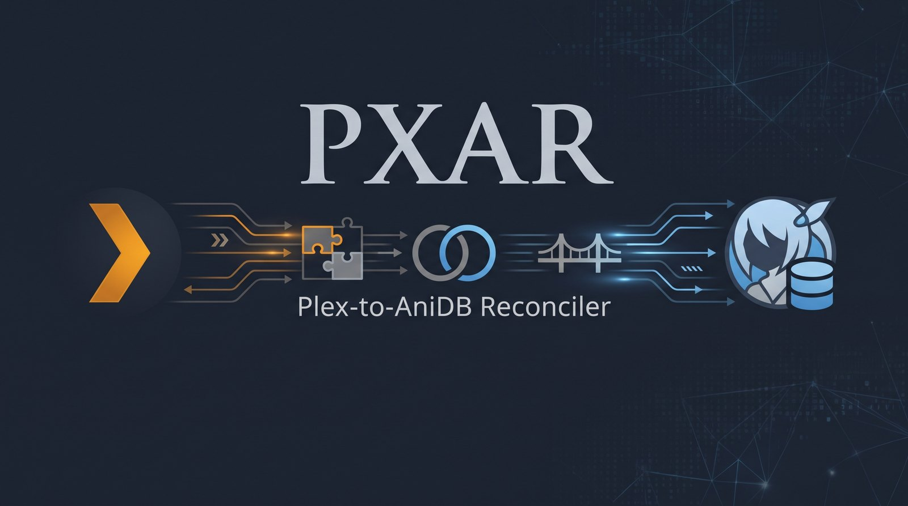

<p align="center">
  
</p>

<p align="center">
  <a href="https://github.com/lusky3/plex-anidb-reconciler/actions/workflows/ci.yml"></a>
  <a href="https://codecov.io/gh/lusky3/plex-anidb-reconciler"></a>
  <a href="https://github.com/lusky3/plex-anidb-reconciler/releases/latest"></a>
  <a href="LICENSE"></a>
  <a href="https://www.python.org/downloads/"></a>
  <a href="https://github.com/lusky3/plex-anidb-reconciler/pkgs/container/plex-anidb-reconciler"></a>
</p>

# plex-anidb-reconciler

Reconciles Plex watched state with AniDB MyList through Shoko Server. Plex tracks watched state per library item,
AniDB per file with a view date, so this tool reads Plex, Shoko and a MyList snapshot, plans per-file changes in both
directions, and writes only the ones it can prove are safe. The console script is `pxar`.

## What it guarantees

Writes are per file: one Shoko file gets one watched date, never a whole episode or series. It won't overwrite an
existing AniDB or Shoko watched date or mark anything unwatched, in Plex or in AniDB.

One case looks like an exception and isn't. If you really replay a *different* release of an episode AniDB already
has as watched, that file gets its own view date (rule R2b), and the date on the other file stays as it is. Set
`R2B_POLICY=ignore` if you don't want that.

- Ambiguous paths and episode links get reported, not acted on. A Plex item backed by several files never reaches
  AniDB; it's marked played in Plex only when AniDB already shows all its episodes watched.
- `plan` is a dry run; only `apply` and `serve` write. A ledger records each write's before and after state, though
  a write cut off by a hard kill (SIGKILL) between the API call and the ledger entry goes unrecorded.

## Requirements

Plex Media Server, Shoko Server with AniDB MyList enabled, and Docker with Compose. The tool was built and tested
against Shoko Server 5.3.3. Plex Pass isn't needed. Tautulli is optional and gives you a run right after each watch.

## Quick start

```sh
cp compose.example.yml compose.yml   # set host paths, network and PLEX_SECTIONS
cp .env.example .env                 # fill in SHOKO_API_KEY and PLEX_TOKEN
sudo install -d -o 10001 -g 10001 /path/to/state-dir   # container runs as uid 10001
docker compose pull
docker compose run --rm plex-anidb-reconciler plan
```

Read the report, then work through the [deployment guide](docs/deployment.md) before you run `apply` or `serve`.

## Commands

| Command | What it does |
| --- | --- |
| `plan [--rules R] [--file-id N] [--rating-key K]` | Dry run. Writes a CSV/HTML report. Uncapped. |
| `apply [--rules R] [--file-id N] [--rating-key K] [--limit N]` | Executes the plan, capped by `MAX_WRITES`. |
| `serve` | Applies every `POLL_MINUTES` and on `POST /trigger`; serves `/healthz`. |
| `healthcheck` | Container probe: exit 0 if the local `/healthz` answers 200. |

`--rules` takes a comma list of `R1`, `R2`, `R2b`; `--rating-key` (repeatable) limits the run to those Plex items. The image runs `serve` by default.

`plan` and `apply` exit with `0` when the run went through, `1` on a config error, `2` when a write or the run failed
(or the command line was wrong), and `3` when the MyList snapshot is missing, unreadable or malformed.

## Documentation

- [How it works](docs/how-it-works.md): matching, rules, safety checks, reason codes, accepted risks
- [Configuration](docs/configuration.md): environment variables
- [Deployment](docs/deployment.md): prerequisites, Shoko settings, rollout, operations, upgrading, recovery
- [Development](docs/development.md): tests, image hardening, CI
- [Changelog](CHANGELOG.md)

Released under the [MIT License](LICENSE).
